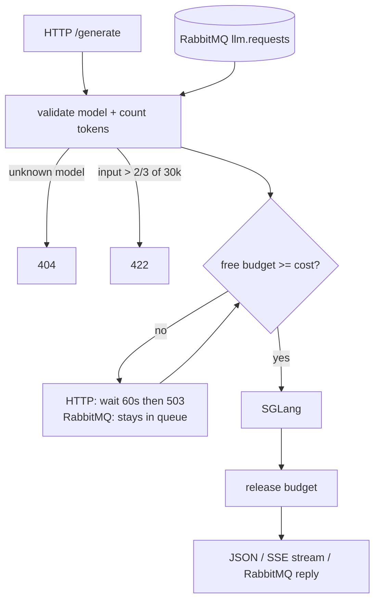
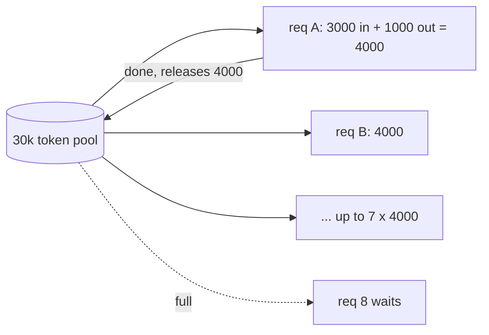
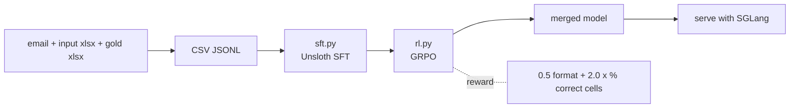

# llm-service

FastAPI + SGLang (Qwen) service with RabbitMQ triggers, a shared token budget, and Unsloth fine-tuning.

```
src/llm_service_main/   service code
finetune/               Unsloth SFT + GRPO (Qwen3-14B)
```

## Quick start
```bash
pip install -e ".[dev]"
python -m sglang.launch_server --model-path Qwen/Qwen3-14B --port 30000
cp .env.example .env
uvicorn llm_service_main.main:app --app-dir src --port 8000
```
`POST /generate` `{"model": "Qwen/Qwen3-14B", "messages": [...], "stream": false}`

## Request flow


## Token budget


## Fine-tuning

```bash
pip install -e ".[finetune]"   # needs NVIDIA GPU
python -m finetune.sft
python -m finetune.rl --init-adapter outputs/qwen3-14b-sft/merged
```
Output columns are set in `finetune/sheets.py` (`OUTPUT_COLUMNS`). Tuning parameters: [docs/flowcharts.md](docs/flowcharts.md).
