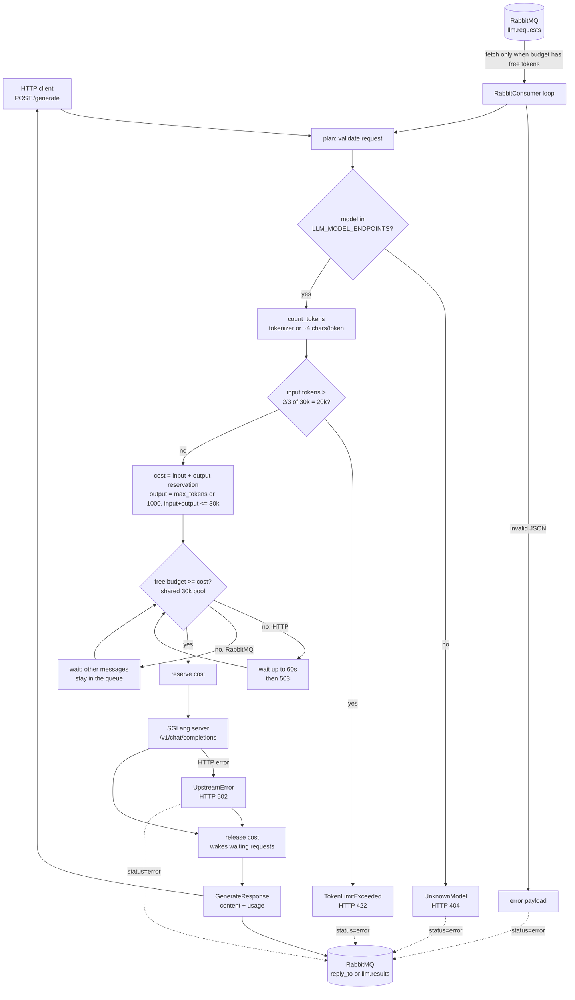
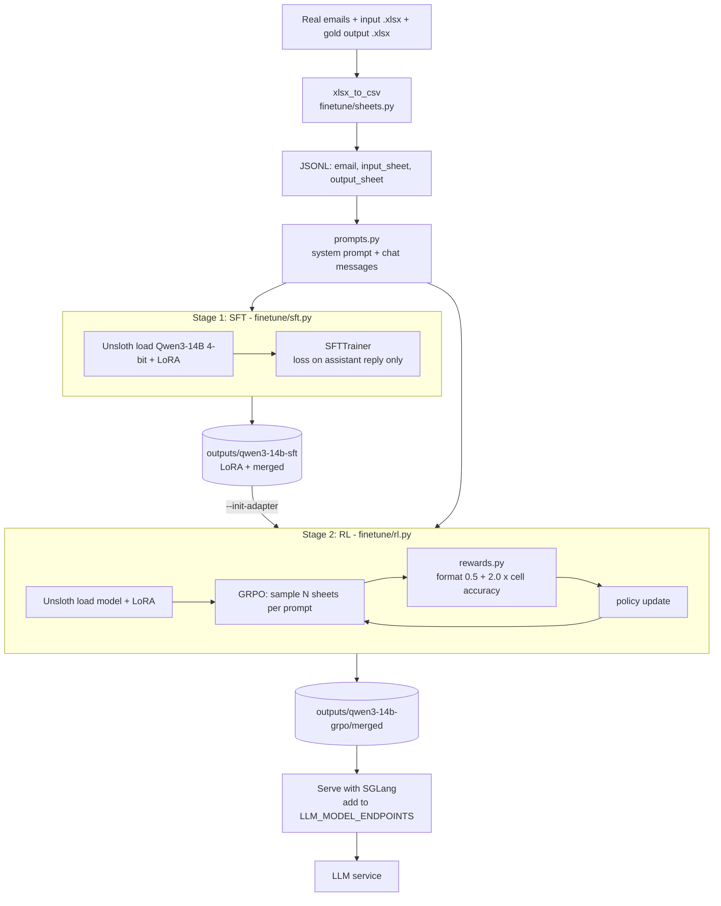

# Flowcharts and tuning guide

Diagrams are Mermaid and render on GitHub / VS Code (Markdown preview with Mermaid support).

## 1. LLM service flow

Example: with a 30k pool, a request with 3000 input tokens reserves 4000 (3000 + 1000 output), so seven run in parallel; the eighth waits (in RabbitMQ for queued requests) until one finishes.

## 2. Fine-tuning flow

## 3. Parameters to improve fine-tuning

Flags marked **CLI** can be set on the command line; **code** means edit the script/config.

### Data (usually the biggest lever)
| What | Guidance |
|---|---|
| Number of examples | SFT: hundreds to a few thousand real email/sheet pairs. The sample files are only for format checking. |
| Coverage | Include add-row, edit-row, delete-row, multi-item emails, messy formatting, missing values. |
| Gold quality | Wrong gold sheets directly teach wrong answers and distort the cell-accuracy reward. |
| Held-out set | Keep ~10% unseen; score it with `cell_accuracy` before/after training. |
| `OUTPUT_COLUMNS` (code, `sheets.py`) | Must match the real format exactly. |

### SFT (`finetune/sft.py`)
| Param | Default | Tune |
|---|---|---|
| `--epochs` CLI | 2 | 1-3. Raise if underfitting; lower if train loss drops but validation accuracy stalls (overfit). |
| `--lr` CLI | 2e-4 | 1e-4 to 2e-4 for LoRA. Lower if loss is unstable. |
| `--lora-r` CLI | 16 | 16 to 64. Higher = more capacity and more memory. Keep alpha = r. |
| `--batch-size` x `--grad-accum` CLI | 2 x 4 | Effective batch 8-32. Raise grad-accum to stabilise without extra memory. |
| `--max-seq-length` CLI | 4096 | Must fit email + input sheet + output sheet. Large sheets need more (memory cost). |
| warmup_ratio, lr scheduler (code) | 0.05, linear | Cosine can help on longer runs. |
| LoRA dropout, target modules (code, `common.py`) | 0, all linear layers | Add small dropout (0.05) if overfitting. |

### RL / GRPO (`finetune/rl.py`)
| Param | Default | Tune |
|---|---|---|
| `--num-generations` CLI | 4 | 8-16 gives a better reward baseline per prompt; costs memory and time. |
| `--lr` CLI | 5e-6 | RL needs much lower LR than SFT. 1e-6 to 1e-5. |
| `--max-steps` CLI | 250 | Watch mean reward; stop when it plateaus. |
| `--max-completion-length` CLI | 1024 | Must fit the whole output sheet, or long sheets get truncated and score 0. |
| `--max-prompt-length` CLI | 1024 | Must fit email + input sheet. |
| `--init-adapter` CLI | none | Always start RL from the SFT model; RL from the base model is slow and unstable. |
| Reward weights (code, `rewards.py`) | format 0.5, accuracy 2.0 | Drop the format weight once the model always gets the header right. |
| Sampling temperature, KL `beta` (code, `GRPOConfig`) | TRL defaults | Higher temperature = more exploration; higher beta = stays closer to the SFT model. |

### Evaluating improvement
1. Run the held-out set through the model, compute `cell_accuracy` per example.
2. Track mean accuracy, % of exact-match sheets, and % with a valid header.
3. Compare base vs SFT vs SFT+GRPO. Only keep GRPO if it beats SFT on the held-out set.
